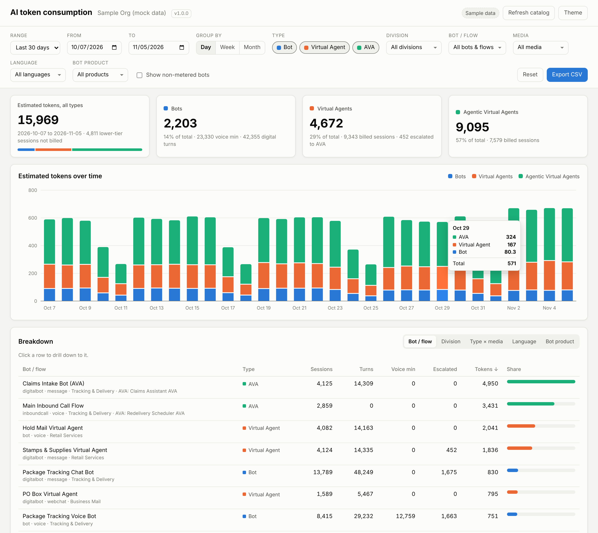

# Genesys Cloud token consumption dashboard

A small Node.js web app that pulls Genesys Cloud usage through the Platform API and shows AI Experience token consumption broken down by **Bots**, **Virtual Agents** and **Agentic Virtual Agents (AVAs)**, with drill-down filters.



## What it shows

- **Totals** for the date range: estimated tokens overall and for each type, with sessions, interactions and voice minutes.
- **Tokens over time**, stacked by type, grouped by day, week or month.
- **Breakdown tables** by bot / flow, division, type × media, language and bot product. Click a row to drill down.
- **Billed tokens from your contract**: the official, org-level token charges and token wallet balance from the Genesys billing API. Use this to check the estimate against the invoice.
- **CSV export** of the filtered daily rows.

Filters: date range (presets or custom), granularity, type (Bot / VA / AVA), division, bot or flow, media type, language, bot product, and an option to include third-party bots that are not charged Genesys tokens. Filter state lives in the URL, so a drill-down view can be bookmarked or shared.

## Token rules

| # | Type | How it is identified | Rule |
|---|---|---|---|
| 1 | Voice bot | Architect voice bot flow with no Virtual Agent and no AVA | Each call is billed in 15 s increments, rounded up. All calls are totaled, rounded up to a whole minute, and divided by 17. |
| 2 | Digital bot | Digital bot flow with no Virtual Agent and no AVA | Prompt/response turns ÷ 51 |
| 3 | Virtual Agent | Bot flow with `virtualAgentEnabled = true` | Sessions ÷ 2, whatever their length (0.5 per session) |
| 4 | Agentic Virtual Agent | Any flow that contains an AVA block (found through Architect dependency tracking) | 1.2 tokens per session, whatever its length |
| 5 | All | | A call or digital conversation consumes tokens only for the highest level of AI it reached. Bot → Virtual Agent costs 0.5; bot → Virtual Agent → AVA costs 1.2. |

To apply rules 1 and 5 exactly, each bot session is read from the bot flow sessions endpoint, which gives its conversation and start and end times. Each call's duration is rounded up to 15 s, and each conversation's highest tier is found. Only the sessions at that tier are billed. Lower-tier sessions are reported as "Escalated". The sessions endpoint has no turn counts, so each flow's daily turns (from the bot aggregate) are spread evenly over that day's sessions. Entries into non-bot flows that contain an AVA are read per conversation from the flow aggregate. The minute rounding in rule 1 is applied once to the voice-bot total for the date range. The extra seconds it adds are shared across the voice-bot rows in proportion to each row's billed seconds, so the tiles, the chart, every breakdown row and drill-downs all add up to the same total. A drill-down shows its share of the bill rather than rounding again on its own. Token consumption is then rounded up to a whole token (per type by default, see `TOKEN_ROUNDING`) and shared across rows the same way, so the tiles show whole tokens and every row, bar and drill-down adds up to them.

The rates can be changed in `.env` if your contract differs. If an org rejects one of these queries, the app falls back to daily totals for that part and says so on the page. Rule 5 cannot be applied to daily totals.

Genesys Cloud does not publish an API that splits token usage by bot, so these figures are calculated from analytics. The billing section shows the official org-level totals to compare against. Third-party bots reached through Bot Connector (Amazon Lex, Google Dialogflow) appear in analytics but are not charged Genesys bot tokens. Bot aggregates have no queue dimension, and division comes from the flow's division.

## Genesys Cloud APIs used

| Purpose | Endpoint |
|---|---|
| OAuth (client credentials) | `POST https://login.{region}/oauth/token` |
| Bot and digital bot flows, VA flag, division | `GET /api/v2/flows?type=bot&type=digitalbot` |
| Agentic Virtual Agents | `GET /api/v2/agentic/virtualagents` |
| Flows that embed each AVA | `GET /api/v2/architect/dependencytracking/consumingresources?objectType=AGENTICVIRTUALAGENT` |
| Division names | `GET /api/v2/authorization/divisions`, `GET /api/v2/flows/divisionviews` |
| Each bot session with its conversation, channel and start/end time (per-call rounding, highest-tier rule) | `GET /api/v2/analytics/botflows/{botFlowId}/sessions` |
| Daily bot turns, bot products, third-party bots | `POST /api/v2/analytics/bots/aggregates/query` |
| Entries per conversation into non-bot flows that contain an AVA | `POST /api/v2/analytics/flows/aggregates/query` |
| Official token charges and wallet | `GET /api/v2/billing/contracts`, `GET /api/v2/billing/contracts/{id}/billingperiods/{periodId}` |
| Optional, unsupported | `GET /api/v2/billing/subscriptionoverview` (the internal endpoint the Admin UI uses; off by default) |

## Setup

1. In Genesys Cloud Admin, create an **OAuth client** with grant type **Client Credentials**, and give it a role with view permissions for:
   - Architect: flows and dependency tracking
   - Analytics: bot aggregates, flow aggregates and bot flow sessions
   - AI Studio / Agentic Virtual Agents: view
   - Authorization: divisions (view)
   - Billing: contracts (view), for the "Billed tokens" section
   If a permission is missing, the API returns 403 and the dashboard shows the message, which names the missing permission. Sections that fail still let the rest of the page load.
2. Give the app the OAuth client's credentials, either from 1Password (below) or in `.env`: copy `.env.example` to `.env` and fill in `GENESYS_CLIENT_ID`, `GENESYS_CLIENT_SECRET` and `GENESYS_REGION` (for example `mypurecloud.com`, `usw2.pure.cloud`, `use2.us-gov-pure.cloud` for FedRAMP orgs). Never commit `.env`.
3. Install and run (Node 18 or later):

   ```bash
   npm install
   npm start          # http://localhost:3000
   ```

### Credentials from 1Password

The app can read the client ID and secret from 1Password through the [1Password CLI](https://developer.1password.com/docs/cli/) (`op`), the same way as the Custom AVA Reporting project. `.env.tpl` holds [secret references](https://developer.1password.com/docs/cli/secret-references/) instead of values, so it is safe to commit:

```bash
GENESYS_CLIENT_ID="op://Work/Genesys GenesysSC12/client_id"
GENESYS_CLIENT_SECRET="op://Work/Genesys GenesysSC12/client_secret"
GENESYS_REGION=mypurecloud.com
```

1. Install the CLI, turn on **Settings > Developer > Integrate with 1Password CLI** in the desktop app, and check you can read the item: `op read "op://Work/Genesys GenesysSC12/client_id"`.
2. Change the vault, item or field names in `.env.tpl` if yours differ.
3. Start the app with `npm run start:op`. That runs `op run --env-file=.env.tpl -- node src/server.js`, which resolves the references when the app starts. The secrets are never written to disk. Other settings still come from `.env` if you have one.

You can also put `op://` references straight into `.env` and start with `op run --env-file=.env -- npm start`. If the app is started without `op run` while a credential still holds an `op://` reference, it stops with a message saying how to start it. On a server without the desktop app, set `OP_SERVICE_ACCOUNT_TOKEN` to a [service account](https://developer.1password.com/docs/service-accounts/) token with read access to the vault, and `op run` uses that.

To try the UI without credentials, run `npm run mock`. It serves generated sample data and labels the page "Sample data".

Docker:

```bash
docker build -t genesys-token-dashboard \
  --build-arg VERSION=$(node -p "require('./package.json').version") \
  --build-arg BUILD_COMMIT=$(git rev-parse --short HEAD) \
  --build-arg BUILD_DATE=$(date -u +%Y-%m-%dT%H:%M:%SZ) .
docker run --env-file .env -p 3000:3000 genesys-token-dashboard
# or with credentials from 1Password:
op run --env-file=.env.tpl -- docker run -e GENESYS_CLIENT_ID -e GENESYS_CLIENT_SECRET -e GENESYS_REGION -p 3000:3000 genesys-token-dashboard
```

## Versioning

The project uses [Semantic Versioning](https://semver.org/). The version in `package.json` is the single source of truth. The running app shows it in the page header, returns it from `GET /api/version` (with the git commit and build date), and sends it on every response as the `X-App-Version` header, for example `1.0.0+4922d91`.

Changes are recorded in [CHANGELOG.md](CHANGELOG.md) under `## [Unreleased]` as you go. To cut a release from an up-to-date `main`:

```bash
npm run release:patch   # bug fixes          1.0.0 -> 1.0.1
npm run release:minor   # new features       1.0.0 -> 1.1.0
npm run release:major   # breaking changes   1.0.0 -> 2.0.0
```

Each command bumps `package.json`, moves the Unreleased notes into a dated section of the changelog, commits, tags `vX.Y.Z` and pushes. It refuses to run if the Unreleased section is empty. Pushing the tag triggers the **Release** workflow, which runs the tests, checks that the tag matches `package.json`, and publishes a GitHub release with the changelog notes and a source zip. The **CI** workflow runs the tests on every pull request and on pushes to `main`.

## Configuration

All settings are environment variables; see `.env.example`. The useful ones beyond credentials:

- `REPORT_TIMEZONE`: IANA time zone used for daily buckets (default `UTC`).
- `ANALYTICS_MAX_DAYS`: long ranges are split into chunks of this many days per analytics query (default 31).
- `CATALOG_CACHE_MINUTES`: how long the flow / AVA catalog is cached (default 15). Usage is cached for 5 minutes so filter changes are fast. The **Refresh** button in the header bypasses both caches and re-fetches everything from Genesys; the header shows when the data was fetched.
- `RATE_*`: token rules 1 to 4 (rule 5 is always on).
- `TOKEN_ROUNDING`: rule 6, the level at which consumption for the date range is rounded up to a whole token: `type` (Bot, Virtual Agent and AVA totals each, the default), `product` (voice bot, digital bot, Virtual Agent and AVA each), `total` (all types together) or `none`.
- `ENABLE_INTERNAL_SUBSCRIPTION_OVERVIEW=1`: also call the undocumented subscription overview endpoint and show its raw response.

## Project layout

```
src/server.js     Express app and JSON/CSV endpoints
src/genesys.js    OAuth client-credentials client with retry on 429/5xx and pagination
src/catalog.js    Flow / VA / AVA discovery and classification
src/usage.js      Analytics queries, token math, filtering and summaries
src/billing.js    Contract billing periods, token charges and wallets
src/mock.js       Sample data for mock mode
src/version.js    App version and build metadata
scripts/          Changelog release helpers used by npm version and the release workflow
.github/workflows CI and release workflows
public/           Web UI (plain HTML, CSS and JS, no build step)
test/             Unit tests (npm test)
```

## Local API

- `GET /api/usage?refresh=1&start=YYYY-MM-DD&end=YYYY-MM-DD&granularity=day|week|month&categories=bot,va,ava&flowIds=&divisionIds=&mediaTypes=&languages=&botProducts=&includeUnmetered=1`
- `GET /api/usage.csv?...` same parameters
- `GET /api/billing?start=&end=`
- `GET /api/catalog[?refresh=1]`
- `GET /api/version`, `GET /api/config`, `GET /api/health`

The server keeps the OAuth secret; the browser only talks to these local endpoints. There is no login on the dashboard itself, so run it on a trusted network or put it behind your own SSO / reverse proxy.
